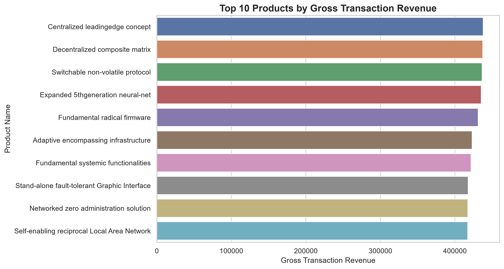
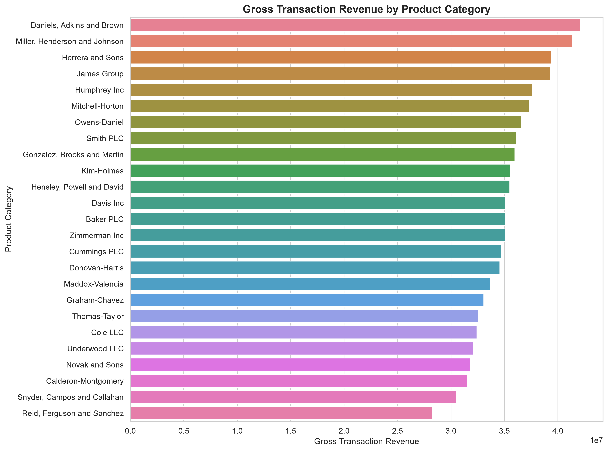
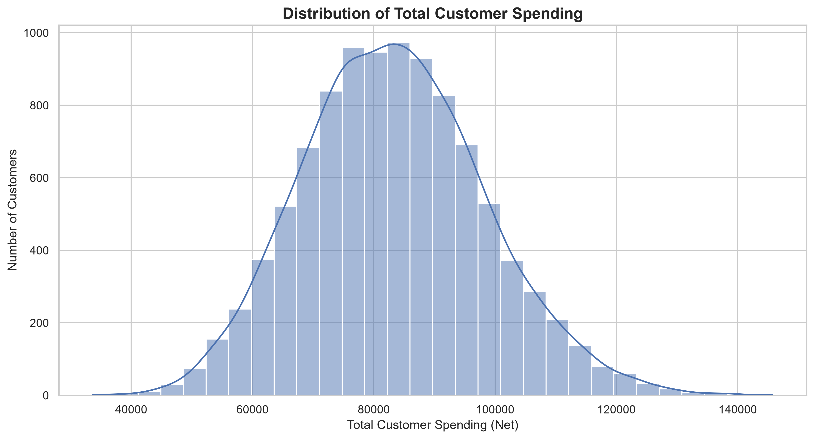
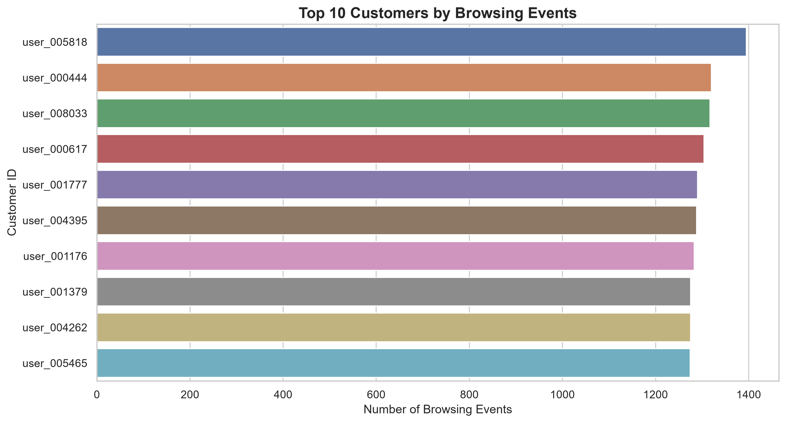
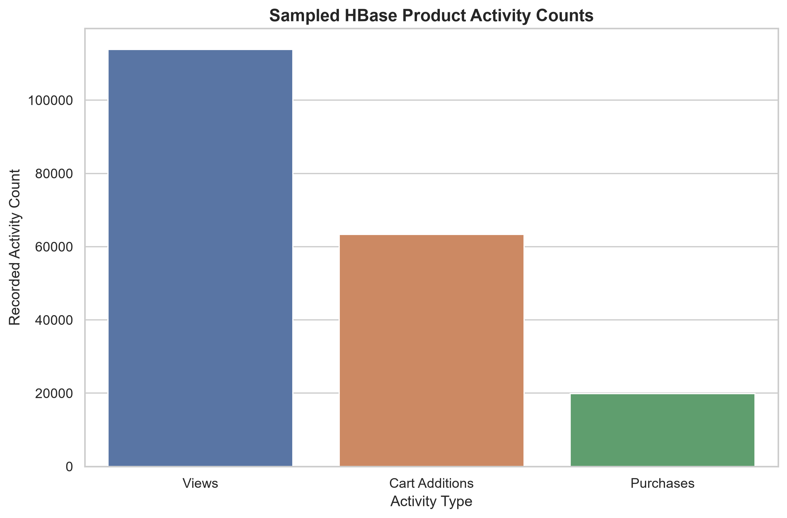
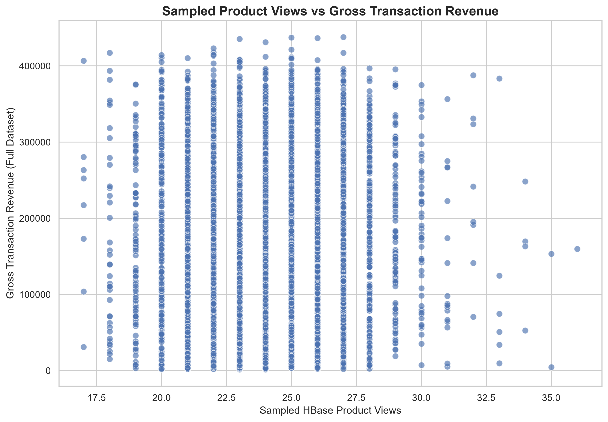

# E-Commerce Big Data Analytics Project

**Adventist University of Central Africa (AUCA)**  
**Final Examination Project — Big Data Analytics**

A multi-model e-commerce analytics project demonstrating how MongoDB, Apache HBase, and Apache Spark can be combined to store, process, integrate, and analyze large-scale transactional and behavioral data.

## Technical Report

**[View the Final Technical Report (PDF)](docs/Ecommerce_Big_Data_Technical_Report.pdf)**

The report documents the system architecture, data modeling, Spark pipelines, cross-system integration, analytical methodology, business insights, visualizations, scalability considerations, and project limitations.

Supporting implementation screenshots are available in [`docs/screenshots/`](docs/screenshots/), and the six analytical visualizations are available in [`visualizations/integrated_analysis/`](visualizations/integrated_analysis/).

---

## 1. Project Overview

This project demonstrates the implementation of a big data analytics architecture for an e-commerce platform using synthetic customer, product, transaction, and browsing data.

The system uses three complementary technologies:

- **MongoDB:** Document-oriented storage for users, products, categories, and transactions.
- **Apache HBase:** Wide-column storage for browsing events and time-based product activity metrics.
- **Apache Spark:** Distributed data cleaning, transformation, aggregation, SQL analytics, and cross-source integration.

The objective is to demonstrate how different storage and processing technologies can support scalable e-commerce analytics and business decision-making.

### Project Objectives

1. Generate and validate a large synthetic e-commerce dataset.
2. Design and implement appropriate MongoDB and HBase data models.
3. Process transactional and behavioral data using Apache Spark.
4. Implement analytical queries, product co-purchase analysis, and customer cohort analysis.
5. Integrate MongoDB and HBase data through a Spark-based batch workflow.
6. Generate business insights and analytical visualizations.
7. Document the implementation, validation evidence, limitations, and reproducibility procedures.

---

## 2. Technologies and Tools

| Technology | Purpose |
|---|---|
| Python | Dataset generation, automation, and implementation |
| MongoDB | Document storage, indexing, and aggregation |
| Apache HBase | Wide-column storage for browsing events and product metrics |
| Apache Spark / PySpark | Distributed processing and analytics |
| Parquet | Reusable columnar analytical outputs |
| Pandas and NumPy | Data manipulation and numerical processing |
| Matplotlib and Seaborn | Analytical visualizations |
| PyMongo | Python connectivity to MongoDB |
| HappyBase | Python connectivity to HBase Thrift |
| Docker Desktop | Containerized HBase environment |
| Jupyter Notebook | Dataset generation and exploration |
| Git and GitHub | Version control and source-code sharing |

The development environment uses Python 3.13.3 and Java 17.

---

## 3. Project Structure

```text
ecommerce_bigdata_final/
│
├── README.md
├── .gitignore
├── requirements.txt
├── dataset_generator.ipynb
├── dataset_generator_extracted.py
├── validate_full_dataset.py
│
├── data/
│   ├── raw/
│   └── processed/
│
├── mongodb/
│   ├── check_mongodb.py
│   ├── create_indexes.py
│   ├── load_transactions.py
│   └── ...
│
├── hbase_project/
│   ├── docs/
│   ├── queries/
│   ├── results/
│   ├── schema/
│   └── scripts/
│
├── spark/
│   ├── 01_clean_normalize.py
│   ├── 02_clean_transactions.py
│   ├── 03_clean_sessions.py
│   ├── 04_audit_missing_values.py
│   ├── 05_validate_core_datasets.py
│   ├── 06_product_recommendations.py
│   ├── 07_customer_cohort_analysis.py
│   ├── 08_verify_cohort_retention.py
│   └── 09_spark_sql_analytics.py
│
├── integration/
│   ├── 01_mongodb_to_spark.py
│   ├── end_to_end/
│   └── hbase_spark/
│
├── results/
│   ├── cohort_analysis/
│   ├── data_quality/
│   ├── integration/
│   ├── recommendations/
│   └── spark_sql/
│
├── visualizations/
│   └── integrated_analysis/
│
└── docs/
    ├── screenshots/
    ├── mongodb_implementation.md
    ├── mongodb_vs_hbase_comparison.md
    ├── part2_spark_processing.md
    ├── part3_analytics_integration.md
    ├── part4_visualization_and_insights.md
    └── docs/Ecommerce_Big_Data_Technical_Report.pdf
```

Some generated datasets, database exports, and local environment files are excluded from GitHub.

The `mongodb/create_indexes.py` file and final report are included in the proposed repository update.

---

## 4. Dataset Description

The project uses reproducible synthetic e-commerce data generated using Python.

### 4.1 Dataset Size

| Dataset | Number of Records |
|---|---:|
| Users | 10,000 |
| Products | 5,000 |
| Categories | 25 |
| Browsing sessions | 2,000,000 |
| Transactions | 500,000 |

The integrated browsing dataset contains **10,301,209 browsing events**.

Generated data includes customer attributes, product catalog information, product categories, browsing behavior, and transaction records.

The generator produces JSON and JSONL files under `data/raw/`.

### 4.2 Dataset Generation

Generate a smaller test dataset:

```powershell
python dataset_generator_extracted.py --test
```

Generate the full dataset:

```powershell
python dataset_generator_extracted.py
```

**Important:** The generator deletes existing `.json` and `.jsonl` files directly inside `data/raw/` before creating new data. Back up any data that must be preserved before rerunning it.

The full dataset has already been generated and used in the project's analytical workflows.

---

## 5. Part 1 — Data Modeling and Storage

### 5.1 MongoDB Implementation

MongoDB stores the following collections in the `ecommerce_analytics` database:

| Collection | Documents |
|---|---:|
| `users` | 10,000 |
| `products` | 5,000 |
| `categories` | 25 |
| `transactions` | 500,000 |
| **Total** | **515,025** |

The document model supports nested transaction items and flexible product attributes.

Indexes support common access patterns, including transaction identifiers, customer identifiers, timestamps, and transaction-item product identifiers.

Implemented analytical queries include:

- Revenue by product category.
- Top-selling products.
- Monthly category revenue analysis.
- Transaction inspection and database verification.

Relevant scripts are available in [`mongodb/`](mongodb/).

Detailed implementation information is provided in [`docs/mongodb_implementation.md`](docs/mongodb_implementation.md).

### 5.2 Apache HBase Implementation

Apache HBase stores behavioral and product activity data in two tables:

| Table | Purpose |
|---|---|
| `ecom:browsing_events` | Customer browsing-event records |
| `ecom:product_metrics` | Time-based product performance metrics |

Browsing-event row keys follow the pattern:

```text
user_id#reverse_timestamp#event_id
```

This supports user-oriented access and time-ordered event retrieval.

Product performance records use product and time information to organize hourly metrics.

Implemented operations include table creation, browsing-event ingestion, user activity retrieval, product metric aggregation, sample loading, and validation.

### 5.3 HBase Product Metrics Scope

The generated hourly product-metrics aggregation contains:

| Metric | Value |
|---|---:|
| Hourly aggregation records | 4,174,030 |
| Products represented | 4,757 |
| Dates represented | 91 |
| Duplicate product/date/hour keys | 0 |

A representative sample of **95,140 product-metrics records** was used for the HBase sample-loading and related visualization workflow.

The sample must not be interpreted as the complete hourly product-metrics dataset.

HBase implementation details are available in [`hbase_project/docs/hbase_integration.md`](hbase_project/docs/hbase_integration.md).

---

## 6. Part 2 — Distributed Processing with Apache Spark

Apache Spark processes the generated e-commerce datasets through cleaning, normalization, validation, and analytical pipelines.

### 6.1 Data Preparation and Validation

The Spark workflow includes:

- Cleaning and normalizing user, product, transaction, and session data.
- Processing nested transaction items.
- Auditing missing values and data quality.
- Validating record counts and analytical consistency.
- Producing reusable analytical datasets.

Core processing scripts are available in [`spark/`](spark/).

### 6.2 Spark SQL Analytics

The implemented Spark SQL workflow produces analytical results for:

- Revenue by product category.
- Monthly revenue.
- Top customers.
- Top-selling products.

### 6.3 Product Co-Purchase Analysis

The project analyzes product combinations appearing together in transactions.

The validated output contains **12,628 product pairs** meeting the implemented minimum-frequency criterion.

The highest observed co-purchase count is four. These low frequencies limit the strength of the resulting recommendation evidence.

### 6.4 Customer Cohort Analysis

Customer cohort analysis groups customers by registration period and examines their subsequent transaction activity.

The implementation identifies 34 registration cohorts.

The synthetic dataset produces 100% observed monthly retention for August–October 2026. This should not be interpreted as realistic customer retention behavior.

### 6.5 Transaction Analytics Results

| Metric | Validated Result |
|---|---:|
| Transactions analyzed | 500,000 |
| Product units sold | 1,752,053 |
| Gross item revenue | 877,342,592.99 |
| Discounts | 43,774,799.75 |
| Net transaction revenue | 833,567,793.24 |

These figures are based on the generated transaction dataset.

Detailed methodology is available in [`docs/part2_spark_processing.md`](docs/part2_spark_processing.md).

---

## 7. Part 3 — MongoDB, HBase, and Spark Integration

The integration workflow combines data from MongoDB and HBase using Apache Spark.

### 7.1 Integration Architecture

```text
                  E-Commerce Data
                         |
              +----------+----------+
              |                     |
           MongoDB                 HBase
      Users, products,       Browsing events,
      categories,            product activity
      transactions                metrics
              |                     |
              +----------+----------+
                         |
                    Data Export
                         |
                  Apache Spark
                         |
              Cleaning and Joining
                         |
               Integrated Analytics
                         |
               Parquet / CSV Outputs
                         |
                 Visualizations
```

The implementation is a **batch integration workflow**. Spark reads exported data rather than performing live federated queries against both databases.

### 7.2 Integration Scripts

| Script | Purpose |
|---|---|
| `02_export_mongodb_collections.py` | Export MongoDB collections |
| `01_export_hbase_tables.py` | Export HBase tables |
| `03_mongodb_hbase_spark_analysis.py` | Perform Spark-based integration |
| `04_export_integrated_results_to_csv.py` | Export integrated CSV outputs |
| `05_validate_integrated_results.py` | Validate integrated results |
| `06_create_integrated_visualizations.py` | Generate visualizations |

The MongoDB exporter and integrated analysis scripts are in `integration/end_to_end/`. The HBase exporter is in `integration/hbase_spark/`.

### 7.3 Integrated Analytical Outputs

| Output | Records | Purpose |
|---|---:|---|
| Product performance | 5,000 | Product-level sales and activity analysis |
| Customer journey | 10,000 | Customer spending and browsing analysis |
| Category performance | 25 | Category-level sales analysis |

The integrated customer dataset represents 10,301,209 browsing events and 2,000,000 browsing sessions.

### 7.4 Financial Reconciliation

The integrated transaction results reconcile as follows:

```text
Gross item revenue       877,342,592.99
Less discounts            43,774,799.75
--------------------------------------
Net transaction revenue  833,567,793.24
```

Gross item revenue represents transaction-item subtotals. Net transaction revenue accounts for discounts.

These measures should not be mixed or compared without explaining their definitions.

### 7.5 Integration Limitations

The integrated product dataset includes 243 products without matched product activity metrics. Missing values should not automatically be treated as zero activity.

The HBase product-metrics sample and the complete MongoDB transaction dataset represent different analytical scopes.

Detailed methodology and validation information are provided in [`docs/part3_analytics_integration.md`](docs/part3_analytics_integration.md).

---

## 8. Part 4 — Data Visualization and Business Insights

Six analytical visualizations are available in [`visualizations/integrated_analysis/`](visualizations/integrated_analysis/).

### Figure 1 — Top Products by Revenue



Compares leading products based on gross transaction revenue.

### Figure 2 — Revenue by Product Category



Shows differences in transaction revenue across product categories.

### Figure 3 — Customer Spending Distribution



Examines how transaction spending is distributed across customers.

### Figure 4 — Top Customers by Browsing Activity



Highlights customers with the highest recorded browsing-event counts.

### Figure 5 — HBase Product Activity Metrics



Summarizes activity counts from sampled HBase product metrics.

These aggregate counts do not constitute a validated customer conversion funnel.

### Figure 6 — Product Views Versus Revenue



Compares sampled HBase product-view metrics with transaction revenue.

Because the two measures have different coverage, the chart is exploratory rather than proof of a causal relationship.

### Business Insights

The analysis supports several observations:

- Transaction revenue differs across products and categories.
- Customer spending varies across the generated customer population.
- Browsing activity is unevenly distributed among customers.
- Product engagement and transaction revenue provide complementary analytical perspectives.
- Combining transactional and behavioral information enables richer product and customer analysis than either source alone.

**Interpretation note:** The dataset is synthetic. These findings demonstrate analytical methods and generated-data patterns, not measured performance of a real commercial platform.

Additional discussion is available in [`docs/part4_visualization_and_insights.md`](docs/part4_visualization_and_insights.md).

---

## 9. Development Environment and Installation

### 9.1 Prerequisites

The project was developed using:

- Windows and PowerShell.
- Python 3.13.3.
- Java 17.
- Apache Spark / PySpark.
- MongoDB.
- Docker Desktop and Apache HBase.
- Git.

MongoDB and HBase require separate local configuration.

### 9.2 Clone the Repository

```powershell
git clone https://github.com/dushimeamieflora/Ecommerce-bigdata-analytics-Project.git

cd Ecommerce-bigdata-analytics-Project
```

### 9.3 Create the Python Environment

```powershell
python -m venv .venv
.\.venv\Scripts\Activate.ps1
```

Install dependencies:

```powershell
python -m pip install --upgrade pip
python -m pip install -r requirements.txt
```

### 9.4 Database Connectivity

The local implementation uses these service endpoints:

| Service | Endpoint |
|---|---|
| MongoDB | `localhost:27017` |
| HBase Thrift | `localhost:9090` |

MongoDB can be inspected using:

```powershell
python mongodb/check_mongodb.py
```

The HBase schema and verification scripts are available under `hbase_project/`.

Do not delete or recreate an existing HBase Docker data volume when troubleshooting the service.

---

## 10. Reproducing the Analytics

Execute commands from the project root.

### Step 1 — Prepare the Dataset

For a test run:

```powershell
python dataset_generator_extracted.py --test
```

For the full generated dataset:

```powershell
python dataset_generator_extracted.py
```

**Warning:** Dataset generation may replace existing raw data files. Preserve existing data before rerunning.

### Step 2 — Prepare MongoDB and HBase

Configure the databases, create the required tables and collections, and load the generated data using the scripts in:

- `mongodb/`
- `hbase_project/schema/`
- `hbase_project/scripts/`

Review the ingestion scripts and existing database contents before rerunning loaders.

### Step 3 — Run Spark Processing

The main Spark scripts are organized sequentially under `spark/`, covering cleaning, validation, recommendations, cohorts, and SQL analytics.

The project includes additional inspection and data-quality scripts for verifying intermediate datasets.

### Step 4 — Export Database Data

After both databases are populated and accessible:

```powershell
python integration/end_to_end/02_export_mongodb_collections.py

python integration/hbase_spark/01_export_hbase_tables.py
```

Inspect existing exports before rerunning. The HBase exporter supports resuming existing exports.

### Step 5 — Execute Integrated Analytics

After the required exports are available:

```powershell
python integration/end_to_end/03_mongodb_hbase_spark_analysis.py

python integration/end_to_end/04_export_integrated_results_to_csv.py

python integration/end_to_end/05_validate_integrated_results.py

python integration/end_to_end/06_create_integrated_visualizations.py
```

**Warning:** The integration workflow can overwrite generated output directories when rerun.

### Step 6 — Inspect Outputs

| Directory | Contents |
|---|---|
| `results/data_quality/` | Data-quality and validation reports |
| `results/spark_sql/` | Spark SQL analytical results |
| `results/cohort_analysis/` | Cohort and retention outputs |
| `results/recommendations/` | Product co-purchase results |
| `results/integration/end_to_end/` | Integrated Parquet and CSV outputs |
| `results/integration/validation/` | Integration validation evidence |
| `visualizations/integrated_analysis/` | Six analytical figures |

A complete fresh-clone reproduction has not been independently verified. Database setup, generation time, resource availability, and existing data state can affect execution.

---

## 11. GitHub Repository and Data Exclusions

The GitHub repository includes source code, documentation, screenshots, selected analytical results, and visualizations.

The `.gitignore` excludes major local or regenerable files, including:

```gitignore
.venv/
__pycache__/
data/raw/
data/processed/
data/temp/
results/integration/hbase_export/
results/integration/mongodb_export/
hbase_project/results/product_metrics_hourly.csv
hbase_project/checkpoints/
/hbase/
*.crc
.env
```

These exclusions keep large datasets, local environments, temporary exports, and the local HBase installation out of new commits.

**Important:** `.gitignore` does not remove files that Git already tracks. Some previously committed analytical Parquet outputs may remain in the repository.

A fresh clone does not contain the complete raw dataset, processed datasets, MongoDB database contents, or HBase database contents. Those resources must be generated, loaded, or restored separately.

---

## 12. Project Status and Verification

### Implemented

- [x] Synthetic dataset generation.
- [x] MongoDB collections and indexing.
- [x] MongoDB aggregation queries.
- [x] HBase table design and sample-based verification.
- [x] Spark data cleaning and validation.
- [x] Product co-purchase analysis.
- [x] Customer cohort analysis.
- [x] Spark SQL analytics.
- [x] MongoDB–HBase–Spark batch integration.
- [x] Integrated output validation.
- [x] Six analytical visualizations.
- [x] Final Technical Report PDF prepared.
- [x] Initial source code published to GitHub.

### Remaining Verification Considerations

- [ ] Independently verify complete reproduction from a fresh clone.
- [ ] Recheck HBase service health whenever rerunning database-dependent scripts.
- [ ] Complete any final assignment-specific submission checks.

Historical successful HBase operations do not guarantee that the service is running in a new environment.

---

## 13. Documentation

| Document | Description |
|---|---|
| [Final Technical Report](docs/Big_Data_Analytics_Final_Exam_101405.pdf) | Final examination report |
| [MongoDB Implementation](docs/mongodb_implementation.md) | MongoDB schema, loading, indexing, and queries |
| [MongoDB vs HBase](docs/mongodb_vs_hbase_comparison.md) | Database comparison and selection rationale |
| [Spark Processing](docs/part2_spark_processing.md) | Data preparation, validation, and analytics |
| [Analytics Integration](docs/part3_analytics_integration.md) | Cross-source integration and analytical outputs |
| [Visualizations and Insights](docs/part4_visualization_and_insights.md) | Figures and business interpretation |
| [HBase Integration](hbase_project/docs/hbase_integration.md) | HBase implementation and validation |

Additional screenshots and implementation evidence are provided in `docs/screenshots/`.

---

## 14. Limitations and Future Improvements

The main project limitations include:

1. **Synthetic data:** Generated customer behavior may not reflect real commercial activity.
2. **Sampled HBase metrics:** The HBase product-metrics workflow does not establish full coverage of the generated hourly metrics.
3. **Batch integration:** MongoDB and HBase exports are processed in batches rather than continuously streamed.
4. **Recommendation sparsity:** Low product co-purchase frequencies limit recommendation quality.
5. **Cohort realism:** Observed 100% retention in selected synthetic periods is not a reliable business retention benchmark.
6. **Operational reproducibility:** Full execution requires database services, sufficient resources, and separately generated data.

Potential improvements include realistic behavioral simulation, broader HBase metric coverage, automated deployment, incremental data ingestion, streaming analytics, improved recommendation algorithms, and automated end-to-end testing.


*This repository is an academic big data analytics implementation and demonstration using synthetic e-commerce data.*